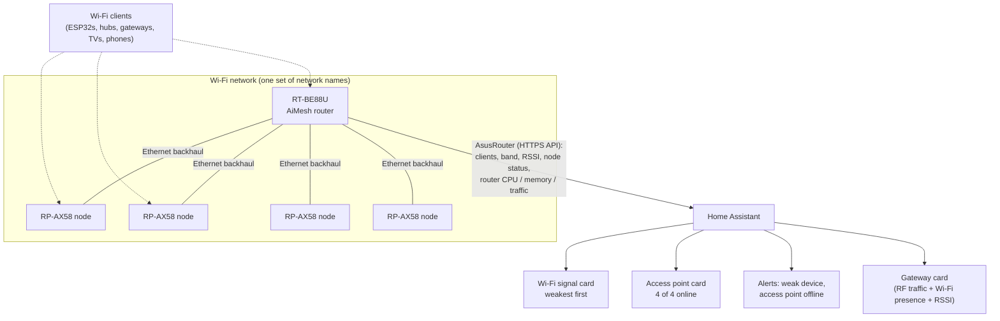

# Home Network Monitoring: ASUS AiMesh + Home Assistant (Commissioned, Trial Running)

**The Wi-Fi network that the building controls depend on, monitored like plant. Four access points were converted to AiMesh nodes on Ethernet backhaul so the router can report every client's signal; Home Assistant now shows per-device RSSI, node health and alerts; and the one trade-off (every node sharing the router's channels) is being measured rather than assumed.**

> **The short version:**
> - **The problem:** a heating gateway kept dropping out, and nobody could tell whether Wi-Fi was to blame. The access points were standalone, so the router saw their clients as "wired", with no signal data.
> - **The fix:** AiMesh with Ethernet backhaul. The router now manages every access point and reports **every Wi-Fi client's signal, band and node**, read into Home Assistant by the AsusRouter integration.
> - **What it gives:** a signal table for every Wi-Fi device (weakest first), a node health card, and alerts for a weak device or an offline access point.
> - **First result:** it proved the gateway's dropouts were **not** Wi-Fi: the stick stayed connected at −62 to −64 dBm through every stall ([gateway case](https://github.com/the-control-cabinet/evohome-heating-controls-ramses-integration/blob/main/docs/B6-gateway-reliability.md)).
> - **The trade-off:** on these models every node uses the router's channels. A baseline scan and a one-week repeat decide whether that costs anything.

**Portfolio position:** Supervisory level · head-end and network health. Related: [head-end health](https://github.com/the-control-cabinet/head-end-health-monitoring) · [ESPHome fleet](https://github.com/the-control-cabinet/esphome-fleet-standards) · [BLE presence](https://github.com/the-control-cabinet/esp32-ble-presence-network) · [O&M pack (record M6)](https://github.com/the-control-cabinet/om-manual-handover-pack/blob/main/docs/03-records-and-reversals.md)

---

## Status at a glance

| Item | Status |
|---|---|
| Four access points converted to AiMesh nodes, Ethernet backhaul (1 Gbps), firmware aligned | ✅ Done (2 Nov 2026) |
| DHCP reservations moved to the nodes' Ethernet MACs | ✅ Done |
| AsusRouter integration replacing ASUSWRT; dependencies migrated | ✅ Done |
| Device trackers enabled for fixed devices (hubs, safety devices, lights, TVs, consoles, appliances) | ✅ Done |
| Wi-Fi signal card and access point card | ✅ Live |
| Weak-signal alert and AP-offline alert | ✅ Live |
| Roaming assistant tuned (−80 dBm on both bands) | ✅ Done |
| Phones and tablets: private Wi-Fi address set to Fixed, duplicates removed | ⏳ To do |
| **Channel-sharing trial:** baseline scan, one-week repeat, decision | ⏳ Baseline pending |

## Why this matters for building controls

In a building, the network is plant. Controllers, gateways and sensors on Wi-Fi fail in ways that look like controls faults: a zone stops reporting, a gateway goes quiet, an actuator misses a command. Without signal data you can't tell **network** from **device**. This project gives the head end the same view a BMS engineer expects of any plant item: **a measured value, a normal band, an alarm when it leaves it, and a record over time.**

## Architecture

## Before and after

| | Before (standalone access points) | After (AiMesh nodes) |
|---|---|---|
| Who manages Wi-Fi | Each access point separately | The router, for all five radios |
| Client signal visible in HA | Only the router's own clients (**5 devices**); everything else "wired" | **Every Wi-Fi client, on every node** |
| Access point health | Not monitored | Per-node connected status, alert after 5 min offline |
| 2.4 GHz channels | Hand-planned 1 / 6 / 11 | All on 1 (20 MHz) |
| 5 GHz channels | 36 and 40 (40 overlapped the router's 80 MHz block) | All on 36 (80 MHz) |
| Network names | Separate 2.4 and 5 GHz names | Unchanged, carried to every node |
| Roaming | Device decides alone | Router assists (802.11k/v); forced disconnect only below −80 dBm |

## Points

| Point | Source | Normal band | Alarm |
|---|---|---|---|
| Wi-Fi signal (RSSI) per device | AsusRouter tracker attribute | ≥ −67 dBm fixed devices | Below −75 dBm for 30 min |
| Band per device | Tracker attribute | 2.4 GHz for IoT, 5 GHz for media | — |
| Presence per device | Tracker state | Home | Used to separate a Wi-Fi drop from a device hang |
| Node connected (×4) | AsusRouter AiMesh entity | Connected | Offline for 5 min |
| Router CPU, memory, temperature | AsusRouter sensors | — | Head-end health (planned) |
| WAN / LAN / 2.4 / 5 GHz traffic | AsusRouter sensors | — | Trend only |

Signal bands used on the card: 🟢 ≥ −60 · 🟡 −61 to −67 · 🟠 −68 to −75 · 🔴 below −75 dBm.

## Key decisions

**1. All nodes, not a hybrid.** A hybrid (some access points as nodes, the rest standalone on their own channels) keeps channel separation, but every device on a standalone access point stays invisible. The point of the project was full visibility, so the hybrid was rejected.

**2. Shared channels, accepted under trial.** ASUS documents per-node channel planning (auto per system, auto per node, manual) only for its ExpertWiFi range. On the RT-BE88U with RP-AX58 nodes the option was not offered, even with Smart Connect switched on for a test (then reversed), and a laptop scan confirmed the node on the router's channels. Access points on one channel take turns rather than interfere; the cost grows with airtime. Most clients here are low-traffic IoT devices and channel 1 measured about 30% busy before the change, so the risk was judged acceptable **if measured** ([doc 03](docs/03-channel-sharing-trial.md)).

**3. AsusRouter over ASUSWRT.** The core integration reports presence, IP and MAC; AsusRouter adds connection type, band, **RSSI**, node status and router health, over the router's HTTPS API.

**4. Track fixed devices first.** Phones and watches use randomised Wi-Fi addresses, appearing twice and making trackers unreliable; they're added once their private address is set to Fixed on the home networks.

**5. Roaming assistant at −80 dBm (was −70).** Stationary devices sitting around −70 to −75 dBm were being disconnected with no better access point to move to.

Full decision record: [doc 01](docs/01-architecture-and-decision.md).

## Results so far

- **Gateway case closed on the network side.** The RAMSES-II gateway stalled five times on the first day; during every stall the router showed it **connected at −62 to −64 dBm**, and it rejoined Wi-Fi by itself after access-point changes. Network ruled out; the fault was isolated to the gateway firmware's radio side and reported upstream.
- **First signal survey (14 devices):** most fixed devices between −21 and −60 dBm; three marginal (−66 to −70 dBm: a Nest smoke detector, a Ring camera, an ESP32 board); one weak (a streaming stick at −77 dBm on 5 GHz). These become the first candidates for moving or adding coverage.
- **Before the change (one-spot scan):** channel 1 at 30-34% utilization across three access points; channel 6 at 9%; channel 11 at 29% (shared with neighbours); 5 GHz channel 36 at 8%. The trial compares against a full five-spot baseline.

## How it was done (summary)

1. **Router:** Ethernet Backhaul Mode on; network names and passwords checked against each access point.
2. **Each access point, one at a time:** record its wireless settings (rollback), switch to AiMesh Node, add it from the router, check Ethernet uplink and clients, align firmware.
3. **DHCP:** reserve each node by its **Ethernet** MAC (node mode uses a different MAC from standalone mode), reboot the node.
4. **Home Assistant:** install AsusRouter, migrate the two ASUSWRT dependencies found by a search across automations, dashboards and configuration, delete ASUSWRT, enable trackers, add cards and alerts.

The runbook, including the pitfalls met (a node that couldn't reach its parent until its firmware was updated, node pages that only work from the router, reservations that silently didn't apply), is in [doc 02](docs/02-conversion-runbook.md).

## Configuration files

| File | What it does |
|---|---|
| [config/cards/wifi-signal-card.yaml](config/cards/wifi-signal-card.yaml) | Markdown card: every device with an RSSI, weakest first, banded |
| [config/cards/access-point-card.yaml](config/cards/access-point-card.yaml) | Markdown card: nodes found by model, name, area, online state, since when |
| [config/automations/wifi-weak-signal-alert.yaml](config/automations/wifi-weak-signal-alert.yaml) | Any device below −75 dBm for 30 min; once per episode |
| [config/automations/access-point-offline-alert.yaml](config/automations/access-point-offline-alert.yaml) | Any node offline for 5 min |
| [config/templates/](config/templates/) | Diagnostic templates: RSSI list, trackers by integration entry, a device by MAC |
| [data/channel-trial.csv](data/channel-trial.csv) | Trial record sheet (pre-change scan filled in) |

Markdown cards use `content: |`: a folded scalar (`>-`) joins the table's lines and breaks the rows.

## Documents

| Doc | Contents |
|---|---|
| [01 Architecture and decision](docs/01-architecture-and-decision.md) | Before and after, why AiMesh, the channel trade-off, options rejected, related settings |
| [02 Conversion runbook](docs/02-conversion-runbook.md) | One access point at a time: checks, conversion, pitfalls, rollback |
| [03 Channel-sharing trial](docs/03-channel-sharing-trial.md) | Method, thresholds, what to do if it fails, results |
| [04 Home Assistant integration](docs/04-home-assistant-integration.md) | AsusRouter vs ASUSWRT, set-up choices, migration, tracker policy |
| [05 Cards and alerts](docs/05-cards-and-alerts.md) | What each card and alert does |

## Lessons

- **Measure the network like plant.** A value, a normal band, an alarm and a history turned "is it the Wi-Fi?" from a guess into a lookup.
- **Visibility has a price; name it and measure it.** Shared channels were the cost of seeing every client. The trial decides whether the price is acceptable.
- **Check what each mode exposes before building on it.** An access point in AP mode reported zero clients to the integration; only the router-managed mode gives the data.
- **Search before deleting.** Two small dependencies (a recorder exclusion and one dashboard card) would have broken silently when the old integration went.
- **One change at a time, with a rollback record.** Each access point's settings were captured before it was converted.

## Skills demonstrated

| Skill | Evidence |
|---|---|
| Network design for OT devices | Mesh with wired backhaul; band and roaming settings chosen for stationary IoT |
| Monitoring and alarm design | Points with normal bands, persistence timers and once-per-episode alerts |
| Fault isolation | Network ruled out for a gateway fault using presence and RSSI during each stall |
| Change control | Per-device rollback records, staged conversion, dependency search before removal |
| Trade-off analysis | Visibility vs channel separation, with a measured trial and exit criteria |
| Home Assistant engineering | Integration migration, templates, markdown cards, template-trigger automations |

## Roadmap

1. Baseline scan (five spots, evening), then the one-week repeat and a decision ([doc 03](docs/03-channel-sharing-trial.md)).
2. Fixed private Wi-Fi addresses on phones and tablets; add them to the signal card.
3. Router health (CPU, memory, temperature, WAN) into the [head-end health](https://github.com/the-control-cabinet/head-end-health-monitoring) KPIs.
4. Act on the marginal devices: move them, or add coverage where several cluster.
5. Re-check ASUS firmware for per-node channel planning on this router; if it arrives, restore 1 / 6 / 11.

No SSIDs, MAC addresses, IP addresses or passwords are published.
