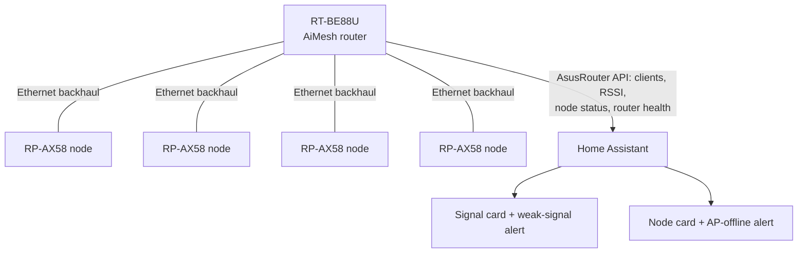

# 01 · Architecture and Decision

[← Back to README](../README.md)

**Decision (2 Nov 2026): all four access points became AiMesh nodes on Ethernet backhaul, accepting shared channels, because only the router can report every client's signal.** The trade-off is under trial ([doc 03](03-channel-sharing-trial.md)).

## Before and after

| | Before | After |
|---|---|---|
| Router | ASUS RT-BE88U | Same, now the AiMesh router |
| Access points | 4 × ASUS RP-AX58, **standalone access points**, cabled | 4 × RP-AX58 **AiMesh nodes**, Ethernet backhaul (1 Gbps) |
| Channels (2.4 GHz) | Hand-planned: 1, 6, 11 | All on the router's channel (1, 20 MHz) |
| Channels (5 GHz) | 36 and 40 (40 overlapped the router's 80 MHz block on 36) | All on 36 (80 MHz) |
| Network names | Separate 2.4 GHz and 5 GHz names | Unchanged: carried through to every node |
| Client signal in HA | Only the router's own Wi-Fi clients (5 devices); the rest looked "wired" | **Every Wi-Fi client, on every node** |

## Why the standalone access points couldn't do it

- The router sees a standalone access point's clients **through its cable**, so it reports them as **wired** with no signal.
- Added to the integration in **Access Point mode**, an RP-AX58 reported **0 connected devices**: it doesn't share its client list in that mode.

## The trade-off: shared channels

ASUS documents per-node channel planning (auto per system, auto per node, manual) only for its **ExpertWiFi** range, which requires Ethernet backhaul and Smart Connect. On the RT-BE88U with RP-AX58 nodes the option was **not offered**, even with Smart Connect switched on for a test (then reversed). A laptop scan confirmed the node on the router's channels. Firmware notes for this router describe one channel fitted to suit every node.

Sharing a channel means access points **take turns** rather than interfere; the cost grows with airtime use. Most clients here are low-traffic 2.4 GHz IoT devices, and channel 1 measured about 30% busy before the change. The trial measures it rather than assuming.

## Options considered

| Option | Signal for every device | Own channels per AP | Verdict |
|---|---|---|---|
| Stay standalone | ❌ | ✅ | Rejected: no visibility |
| **All AiMesh** | ✅ | ❌ | **Chosen**, with a trial |
| Hybrid (some nodes, some standalone) | Partial | Partial | Rejected: devices on standalone APs stay invisible |
| Device-side signal only (ESPHome, Shelly, Ring sensors) | Most fixed devices | ✅ | Kept as a fallback; misses TVs, hubs, phones |
| Business-class Wi-Fi (controller-based) | ✅ | ✅ | The "proper" answer; replaces the access points |
| Ask the gateway firmware to publish RSSI | Gateway only | ✅ | Not pursued: one device, and an upstream dependency |

## Related settings

| Setting | Value | Why |
|---|---|---|
| Roaming assistant | −80 dBm on both bands (was −70) | Stationary devices around −70 to −75 dBm were being disconnected with nowhere better to go |
| 2.4 GHz OFDMA / MU-MIMO | Disabled | Older-device compatibility (kept) |
| 2.4 GHz Tx power | Balance (5 GHz: Performance) | 2.4 GHz travels further; lower power also limits overlap between nodes on one channel |
| DHCP reservations | By each node's **Ethernet** MAC | Node mode requests its address with a different MAC from standalone mode |
